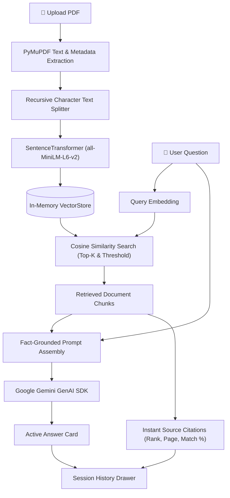

# Personal PDF AI Assistant 📚🤖

A high-performance, fact-grounded Retrieval-Augmented Generation (RAG) assistant for querying and analyzing PDF documents. Built with Python, Streamlit, PyMuPDF, SentenceTransformers, and the Google Gemini GenAI SDK.

---

## 🌟 Key Features

- **Document Extraction & Metadata**: Extracts text, page counts, word counts, and PDF metadata using high-performance PyMuPDF (`fitz`).
- **Semantic Text Chunking**: Splits extracted document content into structured, overlapping chunks with deterministic chunk IDs and page tracing (`langchain-text-splitters`).
- **Local Dense Embeddings**: Embeds text locally using SentenceTransformers (`sentence-transformers/all-MiniLM-L6-v2`, 384 dimensions) for fast, cost-free vector computation without external API dependencies.
- **In-Memory Vector Search**: Fast cosine similarity vector store with Top-K selection, score thresholding, and optional JSON persistence.
- **Fact-Grounded Gemini Answering**: Employs Google Gemini (`google-genai` SDK) with strict system instructions that eliminate hallucinations and ensure passive, reference-only handling of untrusted document content.
- **Focused Single-Query UI**: Clean, distraction-free Q&A interface with quick-ask suggestions ("Summarize Key Takeaways", "Extract Core Findings", "Next Steps & Actions").
- **Instant Source Citations**: Displays exact source citations immediately beneath each generated answer, complete with rank, page number, similarity percentage, and verbatim excerpt quotes.
- **Collapsible Session History**: An expandable history drawer that preserves past questions, answers, and page citations throughout the active session.
- **Security & Secret Sanitization**: Redacts API keys and tokens from all error messages and logs before displaying them to the user.

---

## 🏗️ System Architecture



---

## 📁 Repository Structure

```
.
├── app.py                     # Main Streamlit orchestration application
├── requirements.txt           # Project dependencies
├── .env.example               # Template environment configuration
├── components/
│   ├── pdf_uploader.py        # PDF drag-and-drop uploader & metadata display
│   └── qa_view.py             # Single-query Q&A studio, citation cards & history drawer
├── utils/
│   ├── pdf_handler.py         # PyMuPDF extraction, validation & metadata parsing
│   ├── chunker.py             # Recursive text chunking with deterministic IDs
│   ├── embeddings.py          # SentenceTransformer model caching & embedding generation
│   ├── vector_store.py        # In-memory cosine similarity search vector store
│   └── qa_engine.py           # Gemini API client, grounded prompting & error sanitization
├── tests/
│   ├── test_extraction.py     # Unit tests for PDF parsing & corrupt file handling
│   ├── test_chunker.py        # Unit tests for text chunking & overlap logic
│   ├── test_embeddings.py     # Unit tests for vector generation & validation
│   ├── test_vector_store.py   # Unit tests for vector indexing & similarity search
│   ├── test_qa_engine.py      # Unit tests for Gemini prompt construction & error safety
│   ├── test_qa_view.py        # Unit tests for citation formatting & history tracking
│   └── test_app_integration.py# Integration tests for end-to-end document indexing
└── docs/
    └── superpowers/           # System design specifications and implementation plans
```

---

## 🚀 Getting Started

### 1. Prerequisites
- Python 3.10+ (Python 3.11, 3.12, 3.13, or 3.14 recommended)
- A Google Gemini API key (obtain from [Google AI Studio](https://aistudio.google.com/))

### 2. Virtual Environment Setup
Clone the repository and set up a virtual environment:

```bash
# Clone the repository
git clone <repo-url>
cd "RAG PDF AI"

# Create a virtual environment
python -m venv venv

# Activate the virtual environment
# Windows (PowerShell):
.\venv\Scripts\Activate.ps1
# macOS / Linux:
source venv/bin/activate
```

### 3. Install Dependencies
```bash
pip install -r requirements.txt
```

### 4. Configure Environment Variables
Copy `.env.example` to `.env`:

```bash
cp .env.example .env
```

Open `.env` and fill in your Gemini API key:
```ini
GEMINI_API_KEY=your_gemini_api_key_here
GEMINI_MODEL=gemini-2.5-flash
```

*(Note: You can also enter or override your Gemini API key directly in the Streamlit sidebar at runtime).*

---

## 🖥️ Running the Application

Launch the Streamlit app:

```bash
streamlit run app.py
```

1. Open your browser at `http://localhost:8501`.
2. Upload any PDF document using the file uploader.
3. Once parsed and indexed, enter your question in the Q&A studio or click one of the **Quick Prompts**.
4. View the generated answer and inspect the **Instant Source Citations** directly below.

---

## 🧪 Running the Test Suite

The test suite contains 60 unit and integration tests covering extraction, chunking, embeddings, vector storage, Gemini QA integration, and UI formatting:

```bash
# Run all tests
python -m pytest -v

# Run with warnings summary disabled for cleaner output
python -m pytest -v -W ignore::DeprecationWarning
```

---

## 🛡️ License

MIT License. Feel free to use and adapt this project for your own AI applications.
