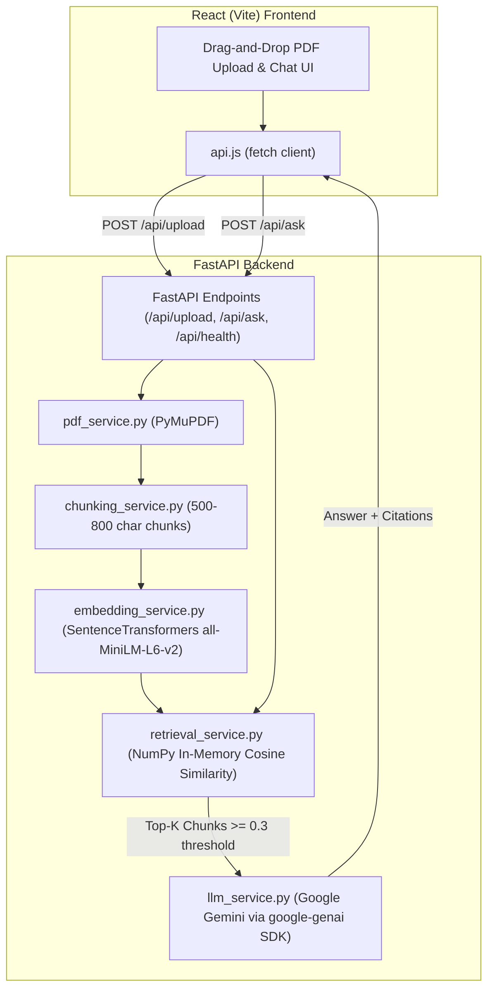

# RAG PDF AI 📚🤖

A full-stack, production-grade Retrieval-Augmented Generation (RAG) web application that enables users to upload PDF documents and ask questions about their content. Answers are fact-grounded in the document and accompanied by instant source page citations and relevance scores.

---

## 🏗️ Architecture Overview

The application follows a clean decoupled client-server architecture:



### Key Technical Decisions
1. **Local Embeddings**: Embeddings run 100% locally on CPU/GPU using `sentence-transformers/all-MiniLM-L6-v2` (384 dimensions), eliminating external embedding API costs and latency. Loaded once at FastAPI startup via lifespan.
2. **In-Memory Vector Search**: Avoids heavy external vector database overhead by computing vectorized cosine similarity directly in NumPy with Top-K selection and relevance threshold filtering.
3. **Threshold Gatekeeping**: If no document chunks pass the relevance threshold (default `0.3`), the system immediately returns `"I couldn't find this in the document"` and avoids calling the LLM entirely, saving API quota.
4. **Google GenAI SDK**: Implements the official `google-genai` SDK (`from google import genai`) with strict system prompts treating document context as untrusted reference data.
5. **Modern React Frontend**: Fast, responsive Vite single-page application with drag-and-drop file upload, quick prompt suggestions, loading states, and transparent source citations.

---

## 📁 Project Structure

```
rag-pdf-ai/
├── backend/
│   ├── app/
│   │   ├── __init__.py
│   │   ├── config.py              # Environment variable configurations
│   │   ├── main.py                # FastAPI app, endpoints, lifespan, CORS
│   │   ├── models.py              # Pydantic schemas for requests/responses
│   │   └── services/
│   │       ├── __init__.py
│   │       ├── pdf_service.py     # PyMuPDF page extraction and validation
│   │       ├── chunking_service.py# Recursive chunker (500-800 chars + overlap)
│   │       ├── embedding_service.py# Local SentenceTransformer model manager
│   │       ├── retrieval_service.py# NumPy cosine similarity & in-memory store
│   │       └── llm_service.py     # Gemini API integration & grounded prompting
│   ├── tests/
│   │   ├── __init__.py
│   │   ├── test_pdf_service.py
│   │   ├── test_chunking_service.py
│   │   ├── test_retrieval_service.py
│   │   └── test_api_endpoints.py
│   ├── requirements.txt
│   └── .env.example
├── frontend/
│   ├── src/
│   │   ├── components/
│   │   │   ├── UploadSection.jsx  # Drag-and-drop uploader with status
│   │   │   └── ChatSection.jsx    # Question input, answer card & source pills
│   │   ├── api.js                 # API client for backend communication
│   │   ├── App.jsx                # Root application layout & state
│   │   ├── index.css              # Clean, responsive styles
│   │   └── main.jsx
│   ├── index.html
│   ├── package.json
│   ├── vite.config.js
│   └── .env.example
└── README.md
```

---

## ⚙️ Environment Variables

### Backend (`backend/.env`)
| Variable | Description | Default |
| :--- | :--- | :--- |
| `GEMINI_API_KEY` | Google Gemini API key from [Google AI Studio](https://aistudio.google.com/) | *(Required)* |
| `GEMINI_MODEL` | Gemini Flash model name | `gemini-2.5-flash` |
| `RELEVANCE_THRESHOLD` | Cosine similarity threshold for retrieved chunks | `0.3` |
| `DEFAULT_TOP_K` | Number of context chunks retrieved for questions | `4` |
| `HOST` | Backend bind host | `0.0.0.0` |
| `PORT` | Backend port | `8000` |

### Frontend (`frontend/.env`)
| Variable | Description | Default |
| :--- | :--- | :--- |
| `VITE_API_BASE_URL` | Base URL of the running FastAPI backend | `http://localhost:8000` |

---

## 🚀 Setup & Installation

### 1. Backend Setup

```bash
# Navigate to backend directory
cd backend

# Create and activate a Python virtual environment
python -m venv venv

# Windows (PowerShell):
.\venv\Scripts\Activate.ps1
# macOS / Linux:
source venv/bin/activate

# Install dependencies
pip install -r requirements.txt

# Configure environment variables
cp .env.example .env
# Edit .env and insert your GEMINI_API_KEY
```

#### Run the Backend Server
```bash
uvicorn app.main:app --reload --host 0.0.0.0 --port 8000
```
The FastAPI backend will start at `http://localhost:8000` (API documentation available at `http://localhost:8000/docs`).

#### Run Backend Tests
```bash
# Run pytest test suite
pytest tests -v
```

---

### 2. Frontend Setup

```bash
# Navigate to frontend directory in a separate terminal
cd frontend

# Install Node dependencies
npm install

# Configure environment variables
cp .env.example .env

# Run Vite development server
npm run dev
```
The React frontend will be accessible at `http://localhost:5173`.

---

## 🧪 Manual Verification Steps

Follow these steps to manually verify that the entire system functions properly:

1. **Verify Backend Health**:
   - Open your browser or run:
     ```bash
     curl http://localhost:8000/api/health
     ```
   - Expect: `{"status": "healthy", "embedding_model_loaded": true, "documents_in_memory": 0}`.

2. **Open the Frontend**:
   - Navigate to `http://localhost:5173`.
   - Verify that the header shows `Backend: Connected` in green.
   - Notice that the **2. Ask Questions** section is disabled until a PDF is uploaded.

3. **Upload a Searchable PDF**:
   - Drag and drop any standard PDF (e.g., a resume, whitepaper, or report < 20MB) into the dropzone or click **Select File**.
   - Observe the loading spinner: *"Parsing & Embedding PDF..."*.
   - Once processed, the uploader displays a green confirmation card with the filename, page count, and total chunk count (e.g. *3 pages • 14 semantic chunks indexed*).
   - Notice that the question input box and quick prompts are now active and enabled.

4. **Ask a Factual Question (Relevant to the Document)**:
   - Type a question that is answered inside the PDF, or click one of the **Quick Prompts** (*"Summarize the key takeaways and main points."*).
   - Click **Ask** or press `Enter`.
   - Observe the loading state: *"Retrieving relevant chunks & formulating grounded answer..."*.
   - Verify that the answer card appears with:
     - The user question and timestamp.
     - The Gemini synthesized factual answer.
     - The **Source References** section underneath showing:
       - **Page pill**: e.g., `Page 2`.
       - **Relevance score**: e.g., `78% match`.
       - **Verbatim snippet**: The exact text excerpt used as context.

5. **Test Relevance Threshold Filtering (Irrelevant Question)**:
   - Ask an absurd question completely unrelated to the PDF topic (e.g., *"What is the recipe for baking chocolate brownies on Mars?"* when viewing a business report).
   - Verify:
     - The answer immediately returns: `"I couldn't find this in the document"`.
     - Zero sources are displayed.
     - The Gemini API is **not** called.

6. **Test Error Handling**:
   - Click **Upload Another PDF**.
   - Attempt to upload an invalid non-PDF file (e.g. a `.txt` or `.png` file).
   - Verify that a clear error message appears: *"Please upload a valid PDF file (.pdf)"*.
   - Attempt to upload an empty file (0 bytes).
   - Verify that a clear error banner appears: *"The uploaded PDF file is empty (0 bytes)"*.

7. **Test Production Build**:
   ```bash
   cd frontend
   npm run build
   ```
   - Verify that the production bundle compiles with 0 errors into `frontend/dist/`.
